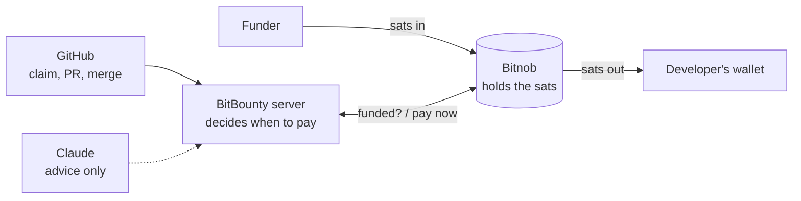

# BitBounty

**Bounties on GitHub issues, paid in sats over Lightning.**
A maintainer puts a price on an issue and funds it in sats (Lightning) or in naira (a Nigerian bank transfer to a Bitnob virtual account). A developer claims it and opens a PR, Claude checks the PR against the issue's acceptance criteria, and the maintainer merges. The developer is then paid in sats to their Lightning Address through [Bitnob](https://bitnob.dev).

Built at **Code & Chain Dakar 2026** (a Bitnob hackathon), 17–18 Oct 2026. **100% of the code was written by AI agents** (see [Built with AI agents](#built-with-ai-agents)). Licensed [MIT](LICENSE).

| | |
| --- | --- |
| Web app | https://bitbounty-app.vercel.app |
| Landing page | https://bitbounty-nine.vercel.app |
| Demo repo (bounties live there) | https://github.com/Djbrl/bitbounty-demo |
| GitHub App (install it on a repo) | https://github.com/apps/bitbounty-dakar |
| Architecture | [docs/architecture.md](docs/architecture.md) |
| Run it locally | [docs/setup.md](docs/setup.md) |

## Why
Btrust's mission, in its own words: "Locating, educating, and remunerating Bitcoin Open-Source Engineers in the Global South." BitBounty is a tool for that kind of work: the public board and profiles **locate** developers by their merged, paid work; Claude's criterion-by-criterion review on every PR **educates**; and the payout in sats minutes after the merge **remunerates**, with no PayPal, Stripe or wire transfer. BitBounty is an independent hackathon project, not affiliated with Btrust or Bitnob.

## How it works, in 60 seconds
1. **The maintainer posts a bounty.** On an issue of a repo where the [GitHub App](https://github.com/apps/bitbounty-dakar) is installed, they comment `/bounty 10000` (the amount the developer gets, in FCFA). The bot answers with one status comment that it keeps editing, and a "Fund this bounty" link. "Price my backlog" on the dashboard can also have Claude suggest which issues to fund, with criteria and a price.
2. **They fund it.** The payment page shows a Lightning invoice in sats (QR code), or a Nigerian bank account number for a naira transfer, converted to BTC on Bitnob. Once Bitnob confirms the payment, the comment switches to **Funded** and the bounty appears on the public board.
3. **A developer claims it.** They comment `/claim`; the issue is theirs for a limited time (`/extend` once, `/unclaim` to give it back). One active claim per issue, so no race between ten PRs.
4. **They open a PR** that says `Fixes #12`. The bot links it to the bounty.
5. **Claude checks it.** A GitHub check, "BitBounty verification", lists each acceptance criterion as met or not, with evidence from the diff. **Claude only advises**: it never moves money.
6. **The maintainer merges.** The merge is the approval (`/hold` stops a payout, `/pay` forces one).
7. **The developer is paid in sats** over Lightning to their Lightning Address: BitBounty converts the FCFA amount to sats at Bitnob's rate, asks the developer's wallet for an invoice for that exact amount (LNURL-pay), and Bitnob pays it. The status comment becomes a receipt.

Payout status (18 Oct): Lightning payouts are merged ([#102](https://github.com/Djbrl/bitbounty/pull/102)): one pay call per attempt so a bounty is never paid twice, a cap in sats per payout (`MAX_PAYOUT_SATS`), and payouts stored in Postgres so a restart resumes them. Bitnob's sandbox refuses the pay call (`403 FEATURE_NOT_ENABLED`, `send_lightning`: Lightning withdrawals aren't enabled on our sandbox account), so the real payment is being proven on Bitnob production.

Agents can fund bounties too: an AI agent with a `bb_` key and a budget set by its human owner posts bounties through the `/v1` API or the MCP server (`packages/mcp`), see [docs/agents.md](docs/agents.md).

## Bitnob APIs used
Every call goes through our typed client, [`packages/bitnob`](packages/bitnob) (details and sandbox results: [docs/bitnob-api.md](docs/bitnob-api.md)).

| What | Bitnob API |
| --- | --- |
| **HMAC auth** | `x-auth-client` / `x-auth-timestamp` / `x-auth-nonce` / `x-auth-signature` (HMAC-SHA256) on every request, fresh nonce and signature on each retry; `GET /api/whoami` to check the keys and the environment |
| **Customers** | `POST /api/customers` (a Lightning invoice and a virtual account both need one) |
| **Lightning invoices** (funding in sats) | `POST /api/lightning/invoices`, then `GET /api/lightning/invoices/:id` polled until paid (Bitnob sends no Lightning webhook) |
| **Virtual accounts, NGN** (funding in naira) | `POST /api/virtual-accounts` (a dedicated Nigerian account number), `simulate-deposit` in the sandbox, then `POST /api/trading/quotes` + `POST /api/trading/orders` to convert NGN to BTC |
| **Rates** | `GET /api/exchange-rates` (USDT ↔ FCFA / NGN) and `GET /api/trading/prices` (BTC ↔ USDT): prices the bounty and converts FCFA to sats |
| **Lightning pay** (payouts) | `POST /api/lightning/pay` with the invoice from the developer's Lightning Address, sent once per attempt with an idempotent `reference`; `POST /api/lightning/decode` to cross-check our invoice decoding |
| **Webhooks** | `POST /webhooks/bitnob`, checked with `x-bitnob-signature` (HMAC-SHA512 of the raw body), stored once per `event_id`: `virtual_account.deposit.success`, payout events |

### How the money moves through Bitnob
Bitnob holds the money between the funding and the payout. GitHub and Claude only decide *when* a bounty may be paid.



## Stack
- **TypeScript everywhere**, pnpm workspaces, Node 22.
- **Server** (`apps/server`): Hono, GitHub App webhooks and commands (`@octokit/app`), funding, settlement and payouts, the web API and the `/v1` agent API.
- **Database**: Postgres 16 with Drizzle ORM (`packages/db`).
- **Web** (`apps/web`): Next.js 15 (App Router), Tailwind 4, Auth.js (sign in with GitHub), on Vercel.
- **AI**: Anthropic API, `claude-sonnet-5-5` by default for the PR verifier and "Price my backlog".
- **Agents**: an MCP server (`packages/mcp`, `@modelcontextprotocol/sdk`) so Claude Code can post and track bounties.
- **Shared contract** (`packages/core`): the bounty state machine, events, commands parser and money helpers.
- **Hosting**: the server, Postgres, a smee.io relay for GitHub webhooks and a Cloudflare tunnel run with Docker Compose; the web runs on Vercel.
- **Tests and lint**: vitest, ESLint.

Diagram and the role of each part: [docs/architecture.md](docs/architecture.md).

## Run it locally
```sh
corepack enable
pnpm install
cp .env.example .env
docker compose up -d db
pnpm db:migrate && pnpm db:seed
pnpm dev          # web on http://localhost:3000, server on http://localhost:8787
```
Without any key, the web runs on demo data and the server on its in-memory stores. The full guide (GitHub App, Bitnob sandbox keys, Claude key, Docker, Vercel) is in [docs/setup.md](docs/setup.md).

## Built with AI agents
**Every line of code in this repo was written by AI coding agents. No human wrote code.** Humans chose and sized the tasks, wrote the briefs, reviewed, tested, decided, merged, and did the non-code work (pitch, demo, design, talking to mentors). The rule is part of the team agreement below.
- **Coding agent:** Claude Code, with **Claude Opus 5.5** (`claude-opus-5-5`). Every PR names the agent and model that wrote it, and agent commits carry the `Co-Authored-By: Claude Opus 5.5` trailer.
- **Models inside the product:** Claude Sonnet 5.5 (`claude-sonnet-5-5`) for the PR verifier and "Price my backlog" (configurable with `VERIFIER_MODEL` / `BACKLOG_MODEL`).

## Team
| GitHub |
| --- |
| [@Djbrl](https://github.com/Djbrl) |
| [@Rabatou](https://github.com/Rabatou) |
| [@Kml221-bot](https://github.com/Kml221-bot) |
| [@cheikhteej](https://github.com/cheikhteej) |

## Docs
| | |
| --- | --- |
| [docs/architecture.md](docs/architecture.md) | Architecture diagram: GitHub, server, Postgres, Bitnob, Claude, web, MCP |
| [docs/setup.md](docs/setup.md) | Run locally, commands, the Docker stack, deploy the web to Vercel |
| [docs/github-app.md](docs/github-app.md) | The GitHub App: permissions, secrets, local webhooks |
| [docs/bitnob-api.md](docs/bitnob-api.md) | Bitnob API cheat sheet and our sandbox results |
| [docs/backlog.md](docs/backlog.md) | "Price my backlog": Claude suggests which issues to fund, with criteria and a price |
| [docs/agents.md](docs/agents.md) | Agents as funders: `bb_` keys, budgets, the `/v1` API and the MCP server for Claude Code |
| [docs/api.md](docs/api.md) | Web ↔ server API: routes, loading and error states |
| [docs/auth.md](docs/auth.md) | Sign in with GitHub (Auth.js) |
| [docs/product.md](docs/product.md) | Product definition, UX flows, edge cases, positioning |
| [docs/plan.md](docs/plan.md) | The original implementation plan (stack, contract, data model, timeline) |
| [TASKS.md](TASKS.md) | The hackathon task board: tasks, points, dependencies, definition of done |

## License
[MIT](LICENSE), © 2026 BitBounty contributors.

---

# Hackathon team rules

The sections below are the team's internal agreement for the hackathon (AI-only code, how a cash prize is split, the points tally). They are kept here unchanged, as agreed by the team.

## Team agreement

Every member agrees to this section before taking a task. Agree by adding your GitHub handle and the time under "Signed" in a commit or PR.

### AI-only code
1. **All code in this repo is written by AI coding agents** (Claude Code, Codex or similar). Humans don't type code: no hand-written functions, no hand edits to source files, no pasted code from elsewhere.
2. Humans do everything else: choose and size tasks, write prompts and briefs, review, run and test, decide, merge, and do the non-code work (pitch, video, demo, design decisions, talking to Bitnob).
3. **Merge conflicts, fixes and refactors are also done by agents.** If an agent gets something wrong, you ask it to fix it; you don't fix it by hand.
4. The only things a human may type directly are secrets and environment values (`.env`, dashboard settings), never committed.
5. **Every PR says which agent and model wrote it** (for example "Claude Code, claude-opus-5-5"). Agent commits carry the agent's co-author trailer.
6. A PR containing human-written code is not merged. If it's discovered after the merge, the task's points are cancelled and the code is redone by an agent.
7. We tell the judges openly that the code is 100% agent-written, and we list the models used in the submission.

### Prize agreement
The split covers any cash prize the team wins (overall placing or partner award).

1. **20% is split equally** among the 4 members.
2. **80% is split in proportion to the points each member completed**, according to [TASKS.md](TASKS.md).
3. **No freeloaders.** To receive the equal 20% share, a member must have completed **at least 10 points** and been present for the demo. If not, their equal share goes back into the 80% pool.
4. **Points count when a task is done**: PR merged (and its done-when met, see rule 11). Non-code tasks (pitch, video, demo, README, submission) earn points like any other.
5. **One PR per task, tested and documented before it's pushed. A PR that breaks this rule earns no points**, even if it gets merged. In practice:
   - **One task = one PR.** No PR that mixes two tasks, no task split across several PRs (except a follow-up fix explicitly requested in review).
   - **Tested:** code tasks ship with automated tests that pass (`pnpm test`). If something really can't be tested automatically (UI, sandbox calls), the PR gives the manual test steps and proof (screenshot, log, response).
   - **Documented:** the PR description says what changes, why, and how to test it. If the behaviour, a command, an endpoint or a variable changes, the matching doc (`docs/`, README, `.env.example`) is updated in the same PR.
   - Non-code tasks (pitch, video, demo): the PR or issue links the deliverable and says how it was checked.
   - **Adversarial review is encouraged, not required** (amended Sat 17 Oct, 22:15, agreed by all 4: in practice reviews couldn't keep up). Reviews are logged in #77.
6. **Adversarial reviews (optional) are worth +0.5 points each** (with the comment listing what was tried), capped at 5 points per person.
7. **Task points are fixed before 15:30 on Saturday**, agreed by 2 members. A task added later is sized by 2 members before anyone takes it. Points don't change after the task is claimed.
8. **Stale tasks:** a claimed task with no commit or message for 90 minutes goes back to the pool. Its points go to whoever finishes it.
9. **Disputes** about a task are settled by the 2 members not involved in it. Their decision is final.
10. The final points tally is written in this README before 14:00 on Sunday and agreed by all 4 members before any money is shared.
11. **Penalties** (added Sat 17 Oct, agreed by all 4), checked against the state of the PR **when it was pushed**:
    - **Done-when not met** → the task earns **0** for its author, and its points go to a **shared pool** split equally between the 4 members.
    - **A bad break** (a crash, a broken build on main, money or data at risk) that decent testing would have caught → **half** the task's points.
    - Fixes made on top of someone's PR are logged in #77 with who did what. The audit is in the tally below.
12. **Captain** (announced by Djbrl, Sun 18 Oct, 02:00): from now on Djbrl is captain for all operations. The captain sizes new tasks and confirms points instead of 2 members (replaces rule 7 for tasks added after this), and decides how a done-when is proven when the original path is blocked (e.g. B6 proven on production because the sandbox can't send Lightning).

**Formula.** For prize P, with your points p and the team total T:
`your share = 0.20 × P / 4 + 0.80 × P × p / T`.
Example with P = $1,000 and points 30 / 28 / 25 / 17 (T = 100): $290, $274, $250, $186.

### Signed
| Member | GitHub | Agreed at |
| --- | --- | --- |
| Jib | @Djbrl | |
| | | |
| | | |
| | | |

### Points tally (final, Sun 18 Oct, 14:30)
Rule 11 applied to every merged PR (per-PR audit: who wrote it, clean or fixed, breaks, done-when at push). To be agreed by all 4 members (rule 10) in the Signed table above.

| Member | Earned | Lost to the pool (done-when not met at push) | Halved (bad break) | Reviews | Points |
| --- | --- | --- | --- | --- | --- |
| Djbrl | W1, W3–W8, G1–G3, G5, A1, A2 (30) · F7 (2) · A5 (2) · L1 (3), U1, U2 (2), U3, U4, U5 (12) · D1 (2), D3 (2), D4 (2), D5 (2), D6 (1), D7 (5) · I5 (1), CR1–CR4 (4) · F4 ½ (1) · W2 ½ (1.5) | F6 (2), W9 (2), G4 (3), B6 (5) | F4: broke main's web build · W2: broken fund link | 12 (+5, capped by rule 6) | **77.5** |
| Rabatou | F2 (3), B4 (3), D2 (3) | F5 (2), B5 (2), B1 (3), B2 (5), B3 (1), I2 (3) | – | ½ credit #91 (+0.25) | **9.25** |
| Kml221-bot | I1 (3), A4 (3), A3 (3), I3 (2), U0 (3) | F1 (3), F3 (2) | – | – | **14** |
| cheikhteej | – | – | – | – | **0** |
| **Shared pool** | | **33 pts → +8.25 each** | | | |

**With the pool:** Djbrl 85.75 · Kml221-bot 22.25 · Rabatou 17.5 · cheikhteej 8.25 · **T = 133.75**.
**Shares** (`0.20 × P / 4 + 0.80 × P × p / T`): Djbrl 56.3 % · Kml221-bot 18.3 % · Rabatou 15.5 % · cheikhteej 9.9 % of the prize.

Final changes since 11:30:
- **Demo (wave 3):** D1 demo repo, D3 rehearsals, D4 backup video, D5 README/docs, D6 submission and D7 landing credited to Djbrl, who did them; D2 pitch deck to Rabatou (#174).
- **B6** (Lightning payouts, merged in #102): done-when (Bitnob reports a real payout paid) never met: production key fails with `401 Invalid HMAC`, sandbox refuses `send_lightning` (403). Rule 11 → **5 pts to the pool**.
- **I5** (CodeRabbit review, #92, 1 pt) and its fixes **CR1–CR4** (#143, #145, #147, #144; 1 pt each) to Djbrl, who set up and ran CodeRabbit. CR5 (#133) needed no change.
- **CR6–CR10** by Kml221-bot (#172/#166, #163, #161, #157, #162) were never sized (rule 7) and count 0 unless 2 members size them before signing.
- **Not done, not counted:** B7 (#87), I4 (#34), I6 (#95).
- **Stays in the pool:** F1, F3, B1, B5 (finished by Djbrl in #51, #72/#74, #80, #78); the rule 9 question is closed that way.
- I2 stays at 0 (offline only, see the verdicts below).

#### Rule 11 verdicts on open PRs (Sat 17 Oct, 23:15)
Each PR was tested as pushed (install, lint, typecheck, tests, build, built server boots) and its feature was exercised by hand. Points only count once the PR is merged (rule 4).

| PR | Task (pts) | Author | Done-when at push | Bad break? | Verdict | Points once merged |
| --- | --- | --- | --- | --- | --- | --- |
| #90 | I1 (3) | Kml221-bot | Met: every page runs on live server data, with loading and error states (checked against a real server + Postgres) | No | **Full** | 3 |
| #76 | A4 (3) | Kml221-bot | Met: an agent key posts a bounty over MCP within its budget; bad key, over budget and a repo it isn't allowed are all refused | No | **Full** | 3 |
| #75 | A3 (3) | Kml221-bot | Met: issue, why it fits, criteria and an FCFA price on a real repo (offline heuristic; the Claude path was never run live) | No | **Full** | 3 |
| #85 | I2 (3) | Rabatou | **Not met**: the done-when says "in sandbox", and the PR says `--sandbox` was never run. Offline it is green 3 times in a row | A `/hold` during the objection window doesn't stop the payout (latent while the window is 0) | **Zero** → 3 pts to the pool | 0 |

| #93 | I3 (2) | Kml221-bot | Met: a failed payout that retries and a claim that expires both show on GitHub and the web | No | **Full** | 2 (merged) |

Rabatou also posted A3 review fixes in #91 (23:09), after Djbrl had taken over the remaining open PRs. #97 superseded it; Djbrl granted **half credit**: +0.25 (half of a rule 6 review bonus).
If all of them are merged as-is (before that +0.25): Kml221-bot **9**, Rabatou **6**, pool **28 pts → +7 each**.
To settle (rule 9): Rabatou may ask the 2 members not involved whether the offline run meets I2's intent, since Wave/OM sandbox payouts are now impossible. If yes, the `/hold` bug argues for half (1.5), not full.

---

## How to work
1. Pick an open task from [TASKS.md](TASKS.md) (or its GitHub issue once created). Assign yourself and comment "on it".
2. Branch `T-<ID>-short-name` (for example `T-B2-payouts`).
3. Give your agent the task row, [docs/plan.md](docs/plan.md) and the contract in `packages/core`. Commits start with the task ID: `B2: retry payouts 3 times`.
4. Before pushing: tests pass (`pnpm test`) or manual proof is attached, and docs are updated if needed.
5. Open **one PR for this task**, with the description: what changes, why, how to test it, which agent and model wrote it. Ask another member to review, and merge once it's been checked.
6. Standup every 2 hours, 5 minutes: done, in progress, blocked.
