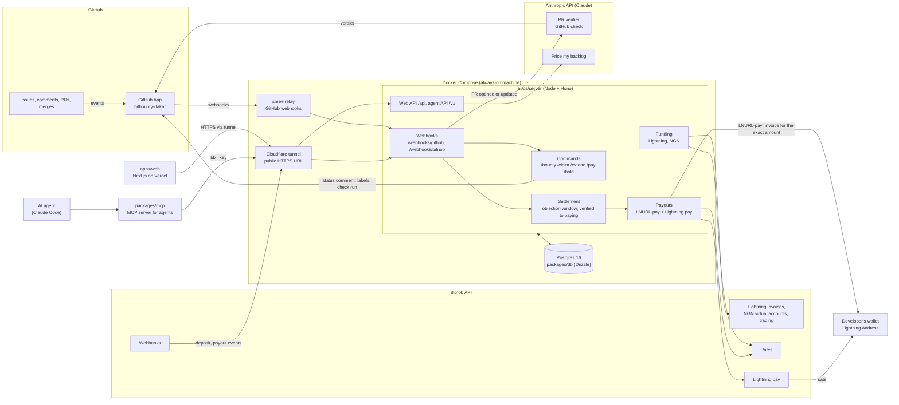

# Architecture

BitBounty sits between the work (GitHub) and the money (Bitnob). The server is the only part that moves a bounty from one state to the next, and only `transition()` in `packages/core` writes a status. Claude produces advice (a verdict, a price), never a payment.

## The parts
| Part | Where | What it does |
| --- | --- | --- |
| **GitHub App** | [github.com/apps/bitbounty-dakar](https://github.com/apps/bitbounty-dakar), [github-app.md](github-app.md) | Sends issue, comment and PR webhooks; the bot reads commands, keeps one status comment per issue up to date, and posts the "BitBounty verification" check on PRs |
| **Server** | `apps/server` | Checks webhook signatures and stores each delivery once (`events` table), parses commands, keeps claims and their timers, links PRs to bounties, prices and funds bounties, runs settlement after the merge, and pays out. Serves the web API (`/api`) and the agent API (`/v1`) |
| **Postgres** | `packages/db` | Bounties, claims, submissions, fundings, payouts, ledger, events, agents. One payout per bounty and one active claim per bounty are enforced by the database. Without `DATABASE_URL` the server uses in-memory stores |
| **Bitnob** | `packages/bitnob`, [bitnob-api.md](bitnob-api.md) | Funding: Lightning invoices (polled, no Lightning webhook) and NGN virtual accounts converted to BTC by a trade. Rates: FCFA, NGN, USDT, BTC. Payouts: `POST /api/lightning/pay` on the invoice from the developer's Lightning Address. Webhooks: naira deposits and payout events, HMAC-SHA512 signed |
| **Claude** | `apps/server/src/ai` | The verifier reads the issue's criteria and the PR diff and returns a verdict per criterion (posted as a GitHub check). "Price my backlog" suggests which open issues to fund, with criteria and a price. Both are advice; a human merges. Without `ANTHROPIC_API_KEY` an offline fake / heuristic is used |
| **Web** | `apps/web`, on Vercel ([bitbounty-app.vercel.app](https://bitbounty-app.vercel.app)) | Maintainer dashboard, payment page, bounty and receipt pages, developer page, proof-of-work profiles, public board, live screen. Sign in with GitHub (Auth.js). Reads the server through `NEXT_PUBLIC_API_URL`; unset, it runs on fixtures |
| **MCP server** | `packages/mcp`, [agents.md](agents.md) | Lets an AI agent (Claude Code) post and track bounties through `/v1` with a `bb_` key, within the budget and repos its human owner allowed |
| **smee + Cloudflare tunnel** | `docker-compose.yml`, [setup.md](setup.md) | smee relays GitHub webhooks to the server without a public URL. A Cloudflare quick tunnel gives the server a public HTTPS URL for the web app, Bitnob webhooks and agents |

## A bounty's life
`unfunded → funded → claimed → submitted → verified → paying → paid`, with side states `on_hold`, `payout_failed`, `refunded`, `cancelled`. The full transition table is in [packages/core/README.md](../packages/core/README.md).

1. `/bounty 10000` → `unfunded`, status comment with a funding link.
2. Lightning invoice paid, or naira deposit converted → `funded`.
3. `/claim` → `claimed` (timer, `/extend` once).
4. PR with `Fixes #n` → `submitted`; Claude's check runs on every push.
5. Merge → `verified`, then the objection window (`/hold` stops it).
6. `paying`: FCFA → sats at Bitnob's rate, LNURL-pay invoice from the Lightning Address checked (exact amount, network, expiry), one `POST /api/lightning/pay` per attempt with an idempotent reference → `paid`, or `payout_failed` after 3 attempts (the money stays reserved for the developer).
